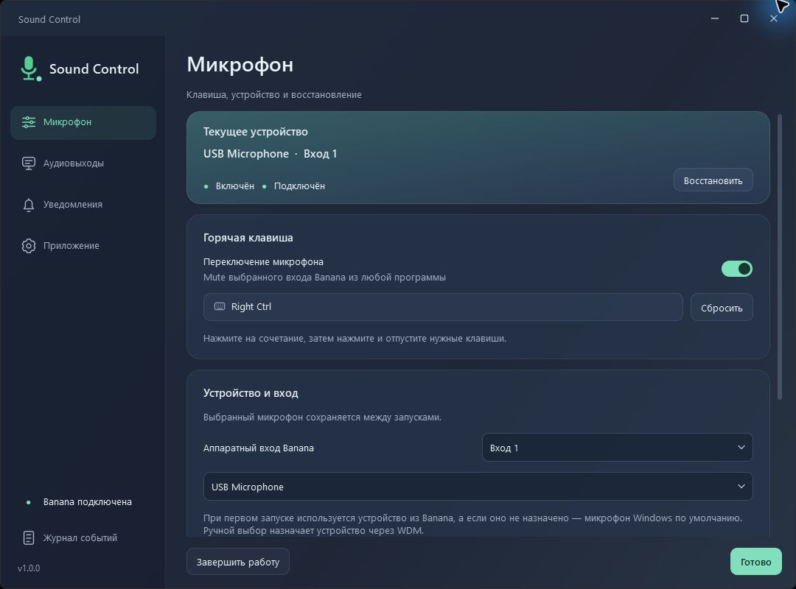
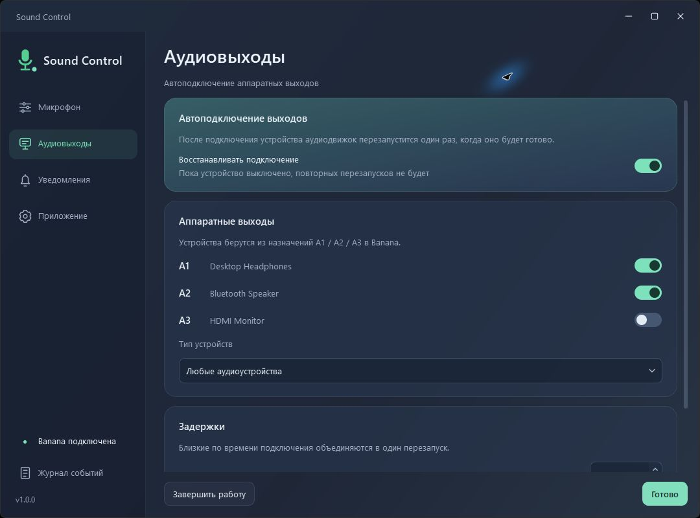
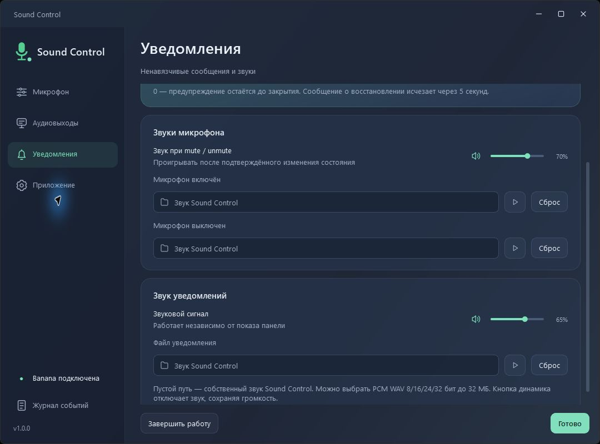
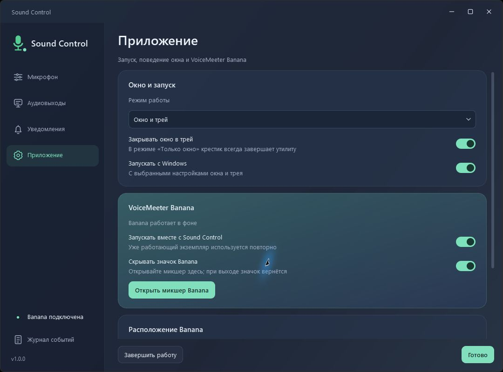
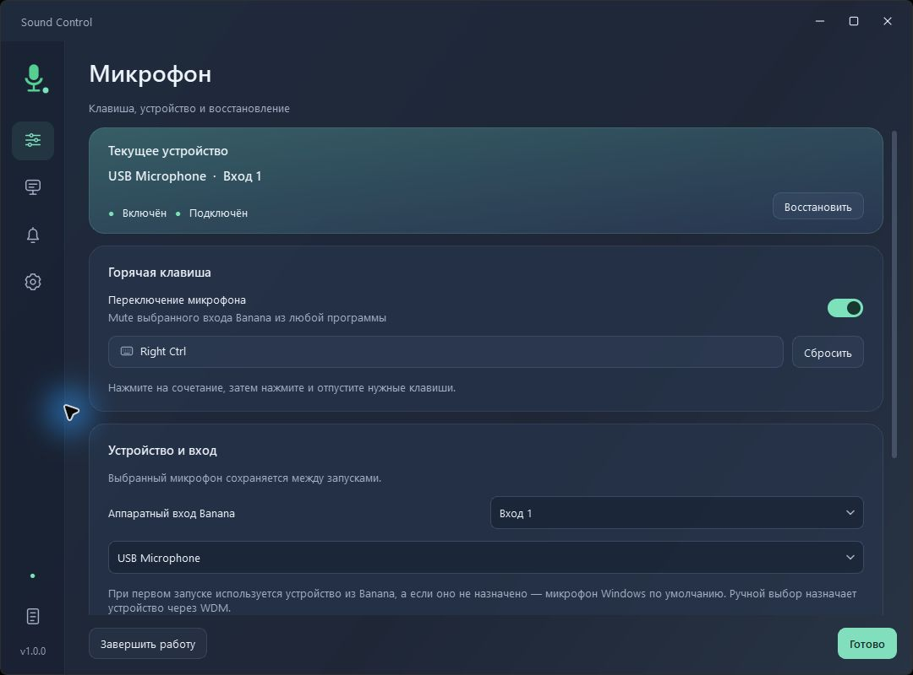
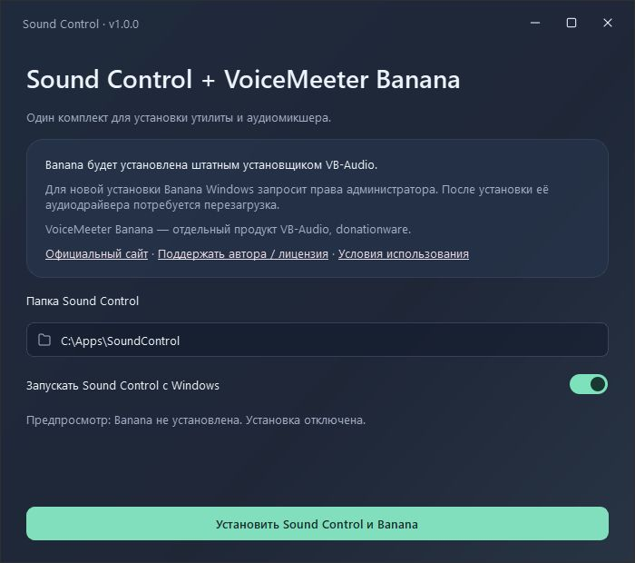

# Sound Control

**Микрофон, устройства и VoiceMeeter Banana — из одной небольшой утилиты.**

Sound Control дополняет **VoiceMeeter Banana**: переключает микрофон по выбранной
клавише, восстанавливает устройства после переподключения и позволяет управлять
фоновым запуском микшера. Готовый EXE работает без Python.

## Скачать

**[Sound Control 1.0.0 — все файлы релиза](https://github.com/AndZas/MicroUtils/releases/tag/sound-control-v1.0.0)**

| Вариант | Когда выбрать |
| --- | --- |
| [EXE](https://github.com/AndZas/MicroUtils/releases/download/sound-control-v1.0.0/SoundControl-1.0.0-windows-x64.exe) | Banana уже установлена; нужен один файл утилиты. |
| [Portable ZIP](https://github.com/AndZas/MicroUtils/releases/download/sound-control-v1.0.0/SoundControl-1.0.0-windows-x64-portable.zip) | Нужна папка с EXE, инструкцией и лицензиями. |
| [Комплект с Banana](https://github.com/AndZas/MicroUtils/releases/download/sound-control-v1.0.0/SoundControl-1.0.0-windows-x64-with-Banana.zip) | Нужно установить и утилиту, и Banana из одного офлайн-комплекта. |
| [Исходники](https://github.com/AndZas/MicroUtils/releases/download/sound-control-v1.0.0/SoundControl-1.0.0-source.zip) | Изучение, доработка и сборка утилиты. |

В релизе также есть **SHA256SUMS.txt**, сведения о сборке и исходники используемых
Qt-компонентов. Сборка предназначена для **Windows 11 x64**; Win32 и отдельной
ARM64-сборки нет. Без установленной Banana один EXE аудиомикшер не заменяет.

## Возможности

- **Своя горячая клавиша.** Запишите клавишу или сочетание для mute входа Banana 1–3.
- **Выбор микрофона.** Устройство сохраняется между запусками; список обновляется при открытии.
- **Восстановление после переподключения.** Для микрофона — повторное назначение, для выбранных выходов — перезапуск аудиодвижка после готовности устройства.
- **Звуки и уведомления.** Три собственных сигнала, независимая громкость групп, свои WAV и небольшие уведомления.
- **Один центр управления.** Запуск Banana, открытие микшера, управление её значком и автозапуском Sound Control.
- **Окно или трей.** Компактное меню, адаптивная боковая панель и нативное управление окном Windows.
- **Работа после сна.** Восстановление наблюдения за устройствами и значка с сохранением одной сессии SDK.

## Быстрый старт

1. Распакуйте выбранный ZIP или поместите EXE в постоянную папку. В общем комплекте запустите `SoundControlSetup.exe`.
2. При первой установке Banana подтвердите запрос прав Windows и перезагрузите компьютер.
3. Настройте в Banana аппаратный выход A1 и микрофон. В Sound Control выберите вход/устройство.
4. Нажмите блок горячей клавиши, запишите сочетание и включите его переключатель. При необходимости включите автоматическое восстановление.

Настройки сохраняются автоматически. Нажатие на основной значок микрофона тоже
переключает mute. Закрытие окна может сворачивать утилиту в трей; «Выход» завершает её.

## Скриншоты

Аудиовыходы и уведомления

Приложение, компактная панель и установка

Скриншоты используют демонстрационные устройства; они не привязывают утилиту к конкретной гарнитуре.

## Документация

- **[Руководство пользователя](docs/USER-GUIDE.md)** — все разделы, первый запуск, восстановление, сон и устранение проблем.
- **[Разработка и сборка](docs/BUILDING.md)** — окружение, тесты, устройство кода и пересборка.
- **[Процесс релиза](docs/RELEASING.md)** — версии, теги, локальные файлы и черновик GitHub Release.
- **[Изменения 1.0.0](CHANGELOG.md)** и **[идеи дальнейшего развития](docs/ROADMAP.md)**.

## Данные и совместимость

Профиль и журнал находятся в `%LOCALAPPDATA%/VoicemeeterMuteTray`.
Историческое имя EXE и каталога профиля сохранено, поэтому обновление использует
существующие настройки. Автозапуск включается по выбору пользователя.

Выбор микрофона Windows назначает WDM-устройство. Уже существующее назначение
Banana определяется автоматически с сохранением его драйвера, если возможно.
Системная маршрутизация Windows и назначения A1/A2/A3 остаются за пользователем.
Во время восстановления аудиодвижок Banana кратко перезапускается.

## Лицензии и обратная связь

Код Sound Control — **[MIT](LICENSE)**. Qt/PySide6 и остальные библиотеки сохраняют
свои лицензии; [уведомления и исходники компонентов](docs/THIRD-PARTY-NOTICES.md)
приложены к поставке. В окне настроек есть кнопка «Лицензии компонентов».

VoiceMeeter Banana — отдельный **donationware**-продукт VB-Audio.
[Официальный сайт](https://voicemeeter.com) ·
[Поддержка автора / лицензия](https://shop.vb-audio.com/en/win-apps/10-voicemeeter-banana.html).
Sound Control не является официальным продуктом VB-Audio.

Нашли проблему или хотите предложить улучшение? Откройте
[Issue](https://github.com/AndZas/MicroUtils/issues/new/choose).
Для изменений кода — [Pull Request и правила участия](../CONTRIBUTING.md).
